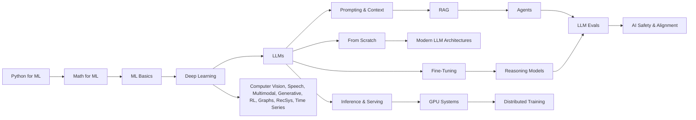

# Awesome AI Roadmaps 

**Learn AI for free, in the right order.** Step-by-step roadmaps from your first line of NumPy to reasoning models, agents, and GPU kernels. Each step links to one specific video, paper, or chapter, so you never have to wade through a 40-hour playlist to find the part that matters.

34 tracks, 362 steps. All free, with no sign-up walls and no paid courses. Every link is machine-checked. Each track ends with **Build it** projects so you finish with something to show.

[Read on the website](https://gruheshkurra.github.io/awesome-ai-roadmaps/) · [Pick a path](#pick-a-path) · [See the map](#the-map) · [All roadmaps](#contents) · [Suggest a resource](https://github.com/GruheshKurra/awesome-ai-roadmaps/issues/new/choose)

> If this saves you time, **star the repo** so others can find it, and share it with one person who is learning AI.

## Pick a path

Hours are rough estimates for watching, reading, and doing the Build-it projects at a steady pace.

- **Complete beginner → first ML model** (~90 h): [Python for ML](tracks/python-for-ml/) → [Math for ML](tracks/math-for-ml/) → [ML Basics](tracks/ml-basics/) → [Deep Learning](tracks/deep-learning/)
- **Software engineer → AI engineer** (~95 h): [LLMs](tracks/llms/) → [Prompting & Context](tracks/prompt-context/) → [RAG](tracks/rag/) → [Agents](tracks/agents/) → [LLM Evals](tracks/eval-harnesses/)
- **Understand how frontier LLMs work** (~150 h): [Deep Learning](tracks/deep-learning/) → [LLMs](tracks/llms/) → [From Scratch](tracks/from-scratch/) → [Modern LLM Architectures](tracks/modern-llm-architectures/) → [Reasoning Models](tracks/reasoning-models/)
- **Train and adapt your own models** (~85 h): [Fine-Tuning](tracks/fine-tuning/) → [Reasoning Models](tracks/reasoning-models/) → [Data-Centric AI](tracks/data-centric/) → [LLM Evals](tracks/eval-harnesses/)
- **Make models fast and cheap** (~95 h): [Inference & Serving](tracks/inference-serving/) → [GPU Systems](tracks/gpu-systems/) → [Distributed Training](tracks/distributed-training/) → [Model Compression](tracks/compression/)
- **Ship ML in production** (~70 h): [ML Basics](tracks/ml-basics/) → [ML Engineering Project](tracks/become-ml-engineer/) → [MLOps](tracks/mlops/)

## The map

## Only have a weekend?

Ten resources that give the most understanding per hour. Start here if you want the big picture before committing to a track.

1. **[Andrej Karpathy — Intro to Large Language Models](https://www.youtube.com/watch?v=zjkBMFhNj_g)** (1 h): what an LLM is, in plain language.
2. **[3Blue1Brown — Transformers, the tech behind LLMs](https://www.youtube.com/watch?v=wjZofJX0v4M)** (30 min): the architecture, visually.
3. **[3Blue1Brown — Attention in transformers, step-by-step](https://www.youtube.com/watch?v=eMlx5fFNoYc)** (30 min): the one mechanism everything depends on.
4. **[Andrej Karpathy — Let's build GPT](https://www.youtube.com/watch?v=kCc8FmEb1nY)** (2 h): code a GPT and watch it learn.
5. **[Andrej Karpathy — Deep Dive into LLMs like ChatGPT](https://www.youtube.com/watch?v=7xTGNNLPyMI)** (3.5 h): pretraining, fine-tuning, and RL end to end.
6. [Anthropic — Building effective agents](https://www.anthropic.com/engineering/building-effective-agents) (20 min): when to build an agent, and when not to.
7. [Sebastian Raschka — Understanding Reasoning LLMs](https://magazine.sebastianraschka.com/p/understanding-reasoning-llms) (30 min): how o1-style and R1-style models are made.
8. [Sebastian Raschka — The Big LLM Architecture Comparison](https://magazine.sebastianraschka.com/p/the-big-llm-architecture-comparison) (45 min): what changed from GPT-2 to today's open models.
9. [Hugging Face — How to generate text](https://huggingface.co/blog/how-to-generate) (20 min): temperature, top-k, and top-p, with code.
10. **[Andrej Karpathy — How I use LLMs](https://www.youtube.com/watch?v=EWvNQjAaOHw)** (2 h): practical habits from someone who builds them.

## Contents

### 1. Foundations

| Track | Covers | Steps |
| --- | --- | ---: |
| [Python for ML](tracks/python-for-ml/) | NumPy, notebooks, pandas, plots. | 9 |
| [Math for ML](tracks/math-for-ml/) | Matrices, derivatives, gradient descent, random variables, Bayes. | 11 |
| [ML Basics](tracks/ml-basics/) | Regression, cross-validation, classification metrics, trees, SVM, clustering, PCA. | 12 |
| [Deep Learning](tracks/deep-learning/) | Backprop, CNNs, RNNs, optimization. | 12 |

### 2. Large language models

| Track | Covers | Steps |
| --- | --- | ---: |
| [LLMs](tracks/llms/) | Transformers, GPT, decoding, sampling, scaling, RLHF. | 14 |
| [From Scratch](tracks/from-scratch/) | Autograd, tokenizers, GPT-2, LayerNorm in C, C/CUDA training. | 8 |
| [Modern LLM Architectures](tracks/modern-llm-architectures/) | RoPE, GQA, FlashAttention, mixture of experts, MLA, DeepSeek-V3, Mamba. | 14 |
| [Reasoning Models](tracks/reasoning-models/) | RLHF, process rewards, test-time compute, GRPO, DeepSeek-R1, reward hacking. | 15 |
| [Fine-Tuning](tracks/fine-tuning/) | LoRA, QLoRA, supervised fine-tuning, DPO, data quality. | 7 |
| [NLP](tracks/nlp/) | Word vectors, tokenization, parsing, RNNs, transformers, BERT. | 14 |

### 3. Building with LLMs

| Track | Covers | Steps |
| --- | --- | ---: |
| [Prompting & Context](tracks/prompt-context/) | Prompt structure, chain-of-thought, context engineering. | 6 |
| [RAG](tracks/rag/) | Embeddings, chunking, vector search, eval. | 8 |
| [Agents](tracks/agents/) | ReAct, tool calling, MCP servers, memory, multi-agent, coding agents, computer use. | 15 |
| [LLM Evals](tracks/eval-harnesses/) | Benchmarks, contamination, SWE-bench, LLM-as-judge, custom eval tasks. | 8 |

### 4. Other modalities and methods

| Track | Covers | Steps |
| --- | --- | ---: |
| [Computer Vision](tracks/computer-vision/) | CNNs, detection, segmentation, ViT. | 12 |
| [Speech & Audio](tracks/speech-audio/) | Spectrograms, CTC, wav2vec, Whisper, TTS. | 11 |
| [Multimodal](tracks/multimodal/) | CLIP, Flamingo, BLIP-2, LLaVA, ImageBind. | 11 |
| [Generative Models](tracks/generative-models/) | VAE, GAN, flows, diffusion, flow matching. | 12 |
| [Reinforcement Learning](tracks/reinforcement-learning/) | MDPs, Q-learning, DQN, policy gradients, PPO, SAC. | 11 |
| [Embodied AI](tracks/embodied-ai/) | Robot simulation, imitation learning, ACT, diffusion policies, OpenVLA, sim-to-real transfer. | 8 |
| [Graph ML](tracks/graph-ml/) | Node embeddings, GCN, PyTorch Geometric, GraphSAGE, GAT, GIN, TransE. | 12 |
| [Recommender Systems](tracks/recsys/) | Collaborative filtering, matrix factorization, Wide & Deep, two-tower, SASRec. | 12 |
| [Time Series](tracks/time-series/) | Time-aware evaluation, naïve baselines, ARIMA, ETS, DeepAR, N-BEATS, TFT, PatchTST. | 14 |
| [Causal ML](tracks/causal-ml/) | Potential outcomes, DAGs, propensity scores, double ML, LATE, causal forests. | 11 |

### 5. Trustworthy AI

| Track | Covers | Steps |
| --- | --- | ---: |
| [AI Safety & Alignment](tracks/evals-safety/) | Alignment, specification gaming, red teaming, toxicity, truthfulness, false refusals. | 13 |
| [Interpretability](tracks/interpretability/) | Permutation importance, PDP, LIME, SHAP, Grad-CAM, TCAV, circuits. | 13 |
| [Data-Centric AI](tracks/data-centric/) | Datasheets, weak supervision, label auditing, synthetic data, filtering. | 13 |

### 6. Systems and production

| Track | Covers | Steps |
| --- | --- | ---: |
| [Inference & Serving](tracks/inference-serving/) | KV cache, quantization, batching, llama.cpp, vLLM, latency and throughput. | 8 |
| [GPU Systems](tracks/gpu-systems/) | CUDA, GPU memory, benchmarking, profiling, mixed precision, Triton kernels. | 8 |
| [Distributed Training](tracks/distributed-training/) | DDP, torchrun, multi-node training, FSDP2, tensor and pipeline parallelism. | 7 |
| [Model Compression](tracks/compression/) | Pruning, quantization, distillation, MobileNetV2, sparse inference. | 8 |
| [MLOps](tracks/mlops/) | Data versioning, pipelines, experiment tracking, model registry, serving, monitoring. | 8 |

### 7. Career practice

| Track | Covers | Steps |
| --- | --- | ---: |
| [ML Engineering Project](tracks/become-ml-engineer/) | Problem framing, data leakage, pipelines, threshold tuning, local serving, model cards. | 9 |
| [ML Research Practice](tracks/become-researcher/) | Paper reading, baselines, ablations, reproducibility, uncertainty, research writing. | 8 |

## How each track works

Every track has the same shape:

- **Goal, prerequisites, and a time estimate**, so you know whether you're ready.
- **Numbered steps.** Each one is a single concept with one video, one reading, or both. Bold links open YouTube.
- **Build it.** Two or three small projects that turn watching into skill. Put them on GitHub; they make a better portfolio than certificates.

## How to learn from this

1. **Pick one path and ignore the rest.** Switching resources feels productive but mostly isn't.
2. **Pause and predict.** Before a video explains something, stop and guess. Being wrong first makes the explanation stick.
3. **Build the tiny version.** If you can't code a 50-line version of an idea, you don't understand it yet.
4. **Retrieve, don't reread.** After each step, close the tab and write down what you remember. Then check.
5. **Read papers in three passes:** abstract and figures, then the method, then the details you need.

## Why this list

There are plenty of AI resource lists. This one is different in three ways:

- **One specific item per step.** You get a link to the lecture, chapter, or section itself, never to a course homepage or a 50-video playlist.
- **Ordered.** Prerequisites come first, so you can follow a track top to bottom.
- **Current.** It covers the 2025–26 stack, including reasoning models, GRPO, MCP, coding agents, and mixture-of-experts architectures, next to the classics that still matter.

Out of scope: paid courses, certificate funnels, and DSA/interview prep.

## Contributing

Found a better video, a broken link, or a missing topic? [Open an issue](https://github.com/GruheshKurra/awesome-ai-roadmaps/issues/new/choose). See [contributing.md](contributing.md) for what makes a good resource. Pull requests that fix links or improve a track are welcome too.

## Star history

## License

[CC0 1.0](https://github.com/GruheshKurra/awesome-ai-roadmaps/blob/main/LICENSE). Do anything you want with this list. The linked resources belong to their authors.
